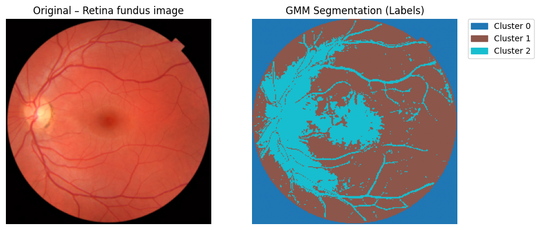
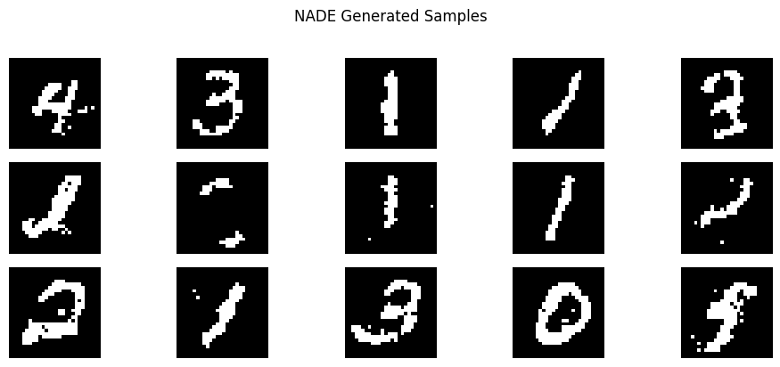

# Probabilistic Modeling and Out-of-Distribution Detection

**Introduction to Machine Learning — Sharif University of Technology**  
**Farzan Aghaei · Mohammadkazem Shahrabi**

A two-phase project on probabilistic density estimation and likelihood-based out-of-distribution (OOD) detection. The implementations cover Gaussian mixture models (GMMs), image segmentation, and neural autoregressive modeling of handwritten digits.

## Phase 1 — Gaussian Mixture Models

Implemented multivariate Gaussian densities and GMM training with the expectation–maximization (EM) algorithm in NumPy. The experiments include:

- **OOD detection:** Fit a two-component GMM to synthetic 2D data and identify low-likelihood samples using a threshold based on the training distribution.
- **Image segmentation:** Cluster image pixels by RGB values using GMM posterior assignments, demonstrated on five images.

[Notebook](phase-1-gmm/GMM_OOD_Image_Segmentation.ipynb) · [Report](phase-1-gmm/Phase_1_Report.pdf)



## Phase 2 — Neural Autoregressive Density Estimation

Implemented a Bernoulli NADE in PyTorch with 784 visible and 500 hidden units. The model is trained on binarized MNIST digits **0–4** and evaluated against unseen digits **5–9** using negative log-likelihood as the OOD score. The implementation also supports sequential image generation.

Results recorded in the project notebook:

| Metric                             | Value |
| ---------------------------------- | ----: |
| Validation negative log-likelihood | 69.48 |
| OOD AUROC                          | 0.807 |

[Notebook](phase-2-nade/NADE_MNIST_OOD_Generation.ipynb) · [Report](phase-2-nade/Phase_2_Report.pdf)



## Running the project

Install the dependencies and launch Jupyter:

```bash
python -m pip install -r requirements.txt
jupyter notebook
```

Open either notebook and run its cells in order. Phase 1 uses datasets available through `scikit-image`. Phase 2 downloads MNIST automatically and trains NADE from scratch; pretrained model weights are not included.
